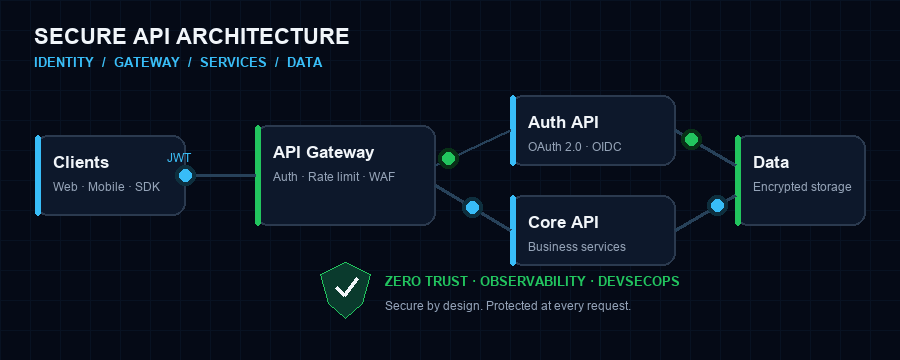
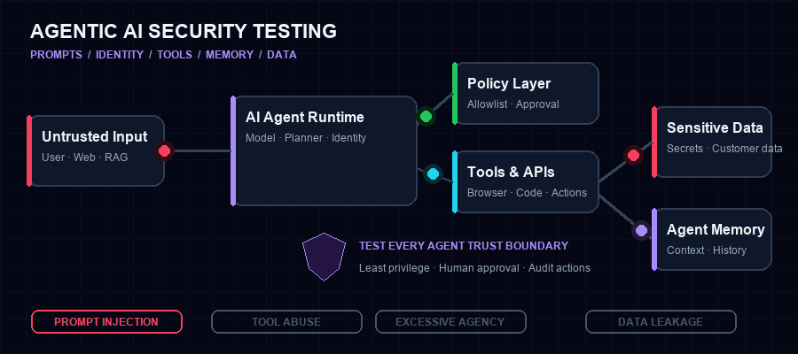

<div align="center">

# Msambili Ndaga

### API Security Professional · Web Security · DevSecOps

#### Cybersecurity Pro · Developer Advocate 🥑 · AI Security Researcher

I test and secure **APIs, web applications, and agentic AI systems** while helping developers build products that are secure by design, easy to integrate, and ready to scale.

[](https://msabenda.github.io/remnant-portfolio/)
[](https://linkedin.com/in/msambili-ndaga)
[](https://twitter.com/msa2benda)
[](mailto:msabenda2@gmail.com)


</div>

---

<div align="center">



</div>

## `whoami`

```text
Role       Developer Advocate @ NEUROTECH AFRICA
Focus      API Security · Web Security · Agentic AI Security · DevSecOps
Research   Security testing for agentic AI systems
Mission    Find security weaknesses early and turn them into practical fixes
Community  APICon Tanzania · APIsec University · NIST/NICE
```

I work at the intersection of **cybersecurity, developer advocacy, and technical research**. At NEUROTECH AFRICA, I help developers integrate products such as **Snippe** and **Ghala** through clear documentation, practical examples, workshops, and hands-on technical support from onboarding to production.

My security work focuses on finding risks across API, web, and AI-powered systems, translating findings into practical fixes, and helping teams adopt a secure-by-design mindset without compromising developer experience.

## Technical Focus

| Area | What I Work With |
|---|---|
| **API Security Testing** | Endpoint discovery, attack-surface mapping, BOLA/BFLA testing, authentication flaws, injection, rate-limit testing, and security validation |
| **Web Security** | Application reconnaissance, access-control testing, session security, injection flaws, security misconfiguration, and OWASP Top 10 testing |
| **Agentic AI Security** | Prompt injection, tool misuse, excessive agency, insecure output handling, context poisoning, data leakage, and trust-boundary testing |
| **Identity & Access** | OAuth 2.0, OpenID Connect, JWT validation, session security, least privilege, and authorization design |
| **Secure API Engineering** | REST and GraphQL security, threat modeling, input validation, error handling, secrets management, and secure-by-design reviews |
| **DevSecOps** | Security gates, SAST/DAST, dependency and container scanning, CI/CD integration, remediation workflows, and observability |
| **Developer Experience** | API documentation, SDK examples, integration guides, developer onboarding, troubleshooting, and technical content |

### Security Research & Engineering Workflow

```text
DISCOVER  →  MODEL  →  TEST  →  REMEDIATE  →  AUTOMATE  →  MONITOR
 endpoints   threats   controls   findings     security     runtime
```

I combine offensive testing with practical engineering guidance: map the attack surface, model trust boundaries, validate controls against realistic abuse cases, communicate risk clearly, and move repeatable checks into the delivery pipeline.

## Agentic AI Security Research

<div align="center">



</div>

I am researching how autonomous and tool-using AI agents can fail across prompts, memory, identity, APIs, plugins, and external systems. My testing focuses on:

- **Prompt and context attacks:** direct and indirect prompt injection, jailbreaks, and context poisoning
- **Tool and API abuse:** unsafe function calls, confused-deputy behavior, and privilege escalation
- **Agency and authorization:** excessive autonomy, missing approval boundaries, and weak least-privilege controls
- **Data protection:** sensitive-data disclosure, memory leakage, and insecure output handling
- **Agent trust boundaries:** insecure agent-to-agent communication, poisoned inputs, and untrusted external content
- **Defensive validation:** guardrails, human-in-the-loop controls, monitoring, auditability, and incident response

## Security Toolkit

**API & Identity**


**AI Security Research**


**Languages & Development**


**Security & Infrastructure**


## Community & Leadership

| Role | Organization |
|---|---|
| Founder & Community Lead | **APICon Tanzania** |
| President | **Cyber Club DIT** |
| Ambassador | **APIsec University** |
| Cybersecurity Ambassador | **NIST / NICE** |
| Governance Artifacts Fellow | **DIT–CEBOT Horizons Alliance** |

I contribute through community building, cybersecurity mentorship, conference speaking, and practical workshops that make API security accessible to more developers across Africa.

## Certifications

- **Certified API Red Team Analyst (CARTA)**
- **API Security Certified Associate (ASCA)**
- **APIsec University Graduate**

## GitHub Activity

<div align="center">


</div>

---

<div align="center">

### Secure APIs. Harden web systems. Test AI agents.

Open to conversations about **API security, web security, DevSecOps, agentic AI security research, developer advocacy, and technical speaking**.

[Portfolio](https://msabenda.github.io/remnant-portfolio/) · [LinkedIn](https://linkedin.com/in/msambili-ndaga) · [X](https://twitter.com/msa2benda) · [Email](mailto:msabenda2@gmail.com)

</div>
